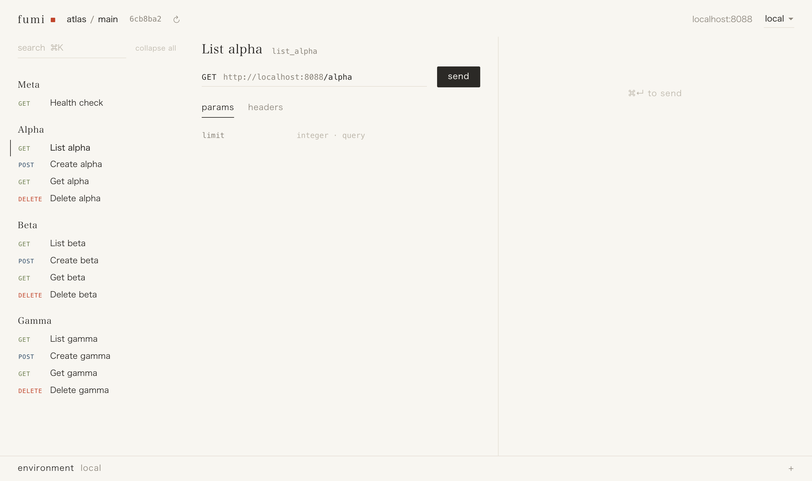
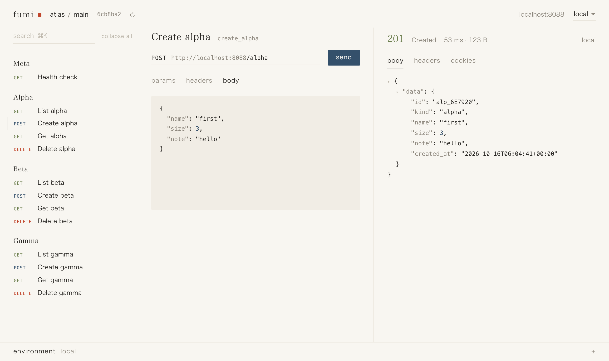

# Fumi

Fumi is an API client that starts from your OpenAPI file. Open the file and every endpoint is there. Switch branches and Fumi switches with you.

## Why

Most API work is sending a request and reading what comes back. API clients are great at that but they make you build and keep a collection by hand. The day you write it it starts to drift from the code.

Your API already describes itself in its OpenAPI file. Fumi starts there. Nothing to import and nothing to keep in sync.

And it follows git. Switch to a branch and Fumi shows that branch's API right away and tells you what changed. Switch back and your open request and last response are waiting where you left them.

## What you get

- Every endpoint from your spec grouped the way the spec groups them
- Requests checked before they go out so a missing field never reaches your server
- Local, dev and prod side by side
- Sign in with your own browser session or an API key
- A confirm step before anything that changes data on prod
- A broken spec never leaves you with a blank screen. You keep the last good one

## Coming next

- Variables. Take a value from one response and use it in the next request
- Saved requests and flows you can share with your team
- History of everything you sent

## Install

```bash
uv tool install git+https://github.com/conscioustahoe/fumi
```

## Use

```bash
fumi path/to/openapi.json
```

Or run `fumi` and open the file from the browser. Fumi runs at http://127.0.0.1:3737.






[Getting started](docs/getting-started.md) · [Design](docs/design.md) · [Apache 2.0](LICENSE)
